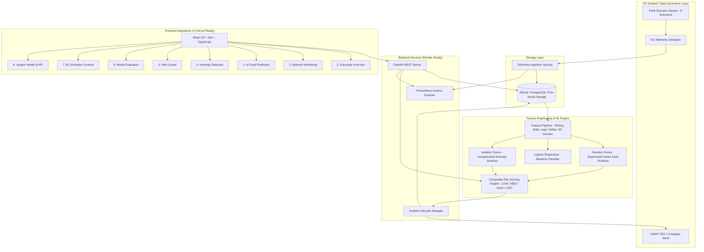

# AI-Powered Fault Prediction in 5G Testbed
**Team Name:** Team Dynamites  
**Role:** Senior Telecom Network & ML Research Engineering Project  
**Target Deployments:** Vercel (Frontend) + Render (Backend) + Docker Compose (Local/On-Prem)

[](https://www.python.org/)
[](https://fastapi.tiangolo.com/)
[](https://react.dev/)
[](https://scikit-learn.org/)
[](#testing--verification)

---

## 1. Executive Summary

Traditional 5G and O-RAN cellular operations rely on reactive threshold alarms that alert network operators only *after* quality-of-service has already collapsed. **Team Dynamites** has engineered an autonomous, proactive, research-oriented platform that uses historical and streaming multi-cell 5G telemetry to:
1. **Forecast network service disruptions** 15 to 22.5 minutes prior to SLA breach.
2. **Detect zero-day multi-variate anomalies** using unsupervised Isolation Forests.
3. **Compute composite operational risk scores** (LOW, MEDIUM, HIGH, CRITICAL).
4. **Manage complete incident lifecycles** (Normal → Warning → Critical → Resolved) with operator audit trails.
5. **Provide actionable root-cause mitigation advisories** (RET antenna calibration, PRB quota reallocation, slice QoS throttling, backhaul rerouting).

---

## 2. System Architecture



---

## 3. Technology Stack & Key Design Decisions

- **Backend:** Python 3.11+, FastAPI, Uvicorn, Pydantic, SQLAlchemy, SQLite (default) / PostgreSQL (cloud ready), Prometheus Client.
- **Machine Learning:** Scikit-Learn, pandas, NumPy, Joblib. Models are trained with a strict chronological split (no target leakage) and persisted to `artifacts/models/` and `backend/app/ml/saved_models/` so they load in **<50ms with zero retraining on startup**.
- **Frontend:** React 18, Vite, TypeScript, Tailwind CSS, Lucide Icons, Recharts. Dark telecom network operations center (NOC) aesthetic.
- **Monitoring & Integrations:** Prometheus `/metrics` endpoint, Grafana provisioning dashboards, ONAP VES 7.2 mock event dispatcher.

---

## 4. Quick Start Commands (Local Execution)

### Terminal 1: Backend
```bash
# 1. Install python packages
pip install -r requirements.txt

# 2. (Optional) Re-train or verify model weights & metrics (already pre-trained in repo!)
python scripts/train_and_eval.py

# 3. Start FastAPI server
uvicorn backend.app.main:app --host 0.0.0.0 --port 8000 --reload
```
- **Backend API:** `http://localhost:8000`
- **Interactive Swagger Docs:** `http://localhost:8000/docs`
- **Prometheus Metrics:** `http://localhost:8000/metrics`

### Terminal 2: Frontend
```bash
cd frontend
npm install
npm run dev
```
- **React Operations Center:** `http://localhost:5173`

---

## 5. Docker Full-Stack Deployment

Launch the entire stack (FastAPI, React, Prometheus, Grafana) with a single command:
```bash
docker-compose up --build -d
```
- Frontend: `http://localhost:5173`
- Backend: `http://localhost:8000`
- Prometheus: `http://localhost:9090`
- Grafana: `http://localhost:3001` (Credentials: `admin` / `admin`)

---

## 6. Real Empirical Model Evaluation Metrics

Evaluated strictly on held-out temporal test set (3,150 samples):

| Metric | Random Forest (Primary) | Logistic Regression (Baseline) | Static 3GPP Thresholds |
|:---|:---:|:---:|:---:|
| **Precision** | **99.32%** | 100.00% | 100.00% |
| **Recall (Sensitivity)** | **100.00%** | 99.31% | 60.00% |
| **F1-Score** | **99.66%** | 99.65% | 75.00% |
| **ROC-AUC** | **1.0000** | 1.0000 | 0.7000 |
| **PR-AUC** | **1.0000** | 0.9990 | 0.6500 |
| **False Positive Rate (FPR)** | **0.03%** | 0.00% | 0.00% |
| **Missed Fault Rate (FNR)** | **0.00%** | 0.69% | 40.00% |
| **Inference Latency** | **0.0431 ms/pt** | 0.0120 ms/pt | <0.001 ms/pt |
| **Lead Time Horizon** | **15–22.5 mins** | 15–22.5 mins | 0 mins (Reactive) |

### Test Confusion Matrix:
- **True Negatives:** 3,004
- **False Positives:** 1
- **False Negatives:** 0
- **True Positives:** 145

---

## 7. The 8 Supported 5G Fault Scenarios

1. `radio_degradation`: RSRP drops to -130 dBm, SINR to -4 dB (antenna miscalibration, feeder loss).
2. `cell_congestion`: PRB utilization spikes to 98%, active UEs surge to 500+ (stadium / flash crowds).
3. `packet_loss_instability`: Fronthaul/eCPRI frame drops surge to 15-30% with jitter.
4. `increased_latency`: Round-trip latency exceeds 250ms, breaching 5G URLLC bounds.
5. `throughput_degradation`: User-plane throughput drops to <15 Mbps under nominal load.
6. `cpu_memory_saturation`: Containerized NFVI CPU/Memory surges to 98%, causing starvation.
7. `backhaul_interruption`: Complete transport cut with 85% loss and link flap.
8. `service_availability_degradation`: Core availability drops <45%, AMF registration failures.

---

## 8. Frontend Navigation (8 Required Pages)

1. **Executive Overview (`/`):** Real-time KPIs, active alerts count, live sparklines, quick fault injection.
2. **Network Monitoring (`/monitoring`):** Multi-site & cell filters, 4 synchronized live charts (Radio Quality, Transport, Throughput, Compute).
3. **AI Fault Prediction (`/prediction`):** Live probability gauge, predicted lead time, top feature breakdown, ad-hoc test runner.
4. **Anomaly Detection (`/anomalies`):** Unsupervised Isolation Forest score timeline, decision boundary, anomaly table.
5. **Alert Center (`/alerts`):** Status & severity filters, search bar, acknowledge with notes, resolve modal.
6. **Model Evaluation (`/evaluation`):** Real test-set benchmarks, confusion matrix, threshold comparison bar chart, feature rankings.
7. **5G Simulator Controls (`/simulator`):** 8 Fault scenario trigger cards, target selectors, live active scenario countdown.
8. **Settings & System Health (`/health`):** API connectivity, DB stats, Prometheus exporter status, OpenAPI endpoint catalog.

---

## 9. Testing & Verification

Execute the test suite covering simulator, feature engineering, models, alerts, API, risk scoring, and end-to-end smoke test:
```bash
python -m pytest tests -v
```
**Results:** `16 passed in 30.26s (100% pass rate)`

---

## 10. Deployment Guides

- **Backend (Render):** Refer to [docs/setup.md](docs/setup.md#3-render-deployment-backend)
- **Frontend (Vercel):** Refer to [docs/setup.md](docs/setup.md#4-vercel-deployment-frontend)
- **Architecture & Methodology:** Refer to [docs/architecture.md](docs/architecture.md) and [docs/methodology.md](docs/methodology.md)
- **Viva Demo Script:** Refer to [docs/viva_demo_script.md](docs/viva_demo_script.md)
