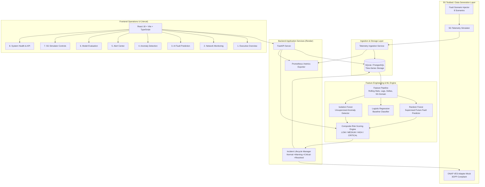
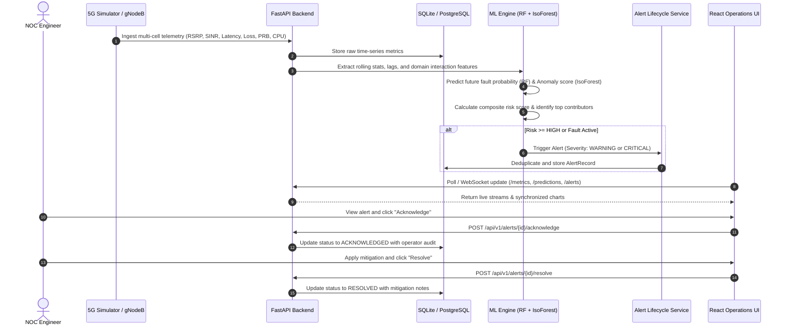

# System Architecture: AI-Powered Fault Prediction in 5G Testbed
**Team:** Team Dynamites  
**Version:** 1.0.0 (Production / Research Grade)

---

## 1. High-Level System Architecture

The platform architecture follows a modular, cloud-ready, event-driven design that separates data generation, collection, feature processing, machine learning inference, incident lifecycle management, and dashboard visualization.

---

## 2. Telemetry and ML Data-Flow Sequence

---

## 3. Supported 5G Network Topologies & Fault Dimensions

1. **Topology:**
   - Multi-Site: `SITE-01` (Urban Macro), `SITE-02` (Sub-Urban), `SITE-03` (Industrial Campus)
   - Multi-Cell: `CELL-01`, `CELL-02`, `CELL-03`
   - Component Hierarchy: `RU-RadioUnit`, `gNodeB-DU`, `gNodeB-CU`, `5G-Core-UPF`, `5G-Core-AMF`

2. **Fault Catalog (8 Standard 3GPP / O-RAN Scenarios):**
   - **Radio Degradation:** Severe RSRP/SINR drop, azimuth drift, or feeder fault.
   - **Cell Congestion:** Extreme PRB exhaustion and UE connection spikes.
   - **Packet Loss & Jitter:** Fronthaul/eCPRI transport frame drops.
   - **Increased Latency:** RTT delay exceeding URLLC 5G SLA boundaries.
   - **Throughput Collapse:** MIMO rank and CQI degradation under nominal load.
   - **NFVI Compute Saturation:** Containerized NF CPU/Memory thrashing.
   - **Backhaul Interruption:** N2/N3 fiber link flaps and packet loss spikes.
   - **Core Availability Degradation:** AMF/NRF signaling registration failure.
